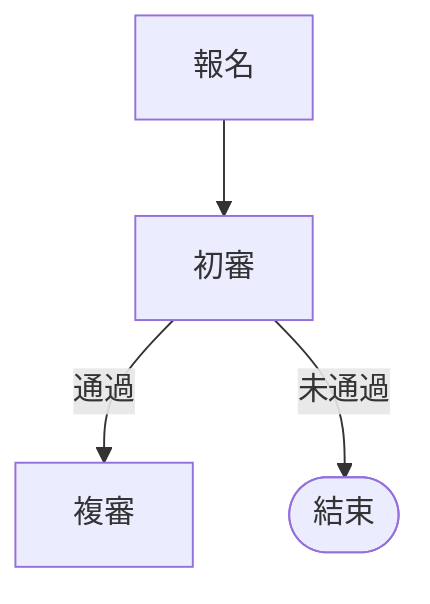

# 在文章裡畫圖：Mermaid 使用指南

網站的 Markdown（部落格文章、About、專案說明）可以直接寫 [Mermaid](https://mermaid.js.org) 語法，網站會把它畫成圖，配色會自動套用網站的黑底、灰線、白字。

## 最快上手

在文章任何地方放一個 `mermaid` 程式碼區塊：

````markdown

````

存檔後在 `pnpm dev` 打開那篇文章就看得到。

> 寫草稿時可以先到 [Mermaid Live Editor](https://mermaid.live) 即時預覽，確定沒問題再貼回文章。注意那是外部網站，請不要貼私人內容。

## 一定要寫：`accDescr`

`accDescr:` 這行不會畫在圖上，但會變成圖片的替代文字，給看不到圖的人（螢幕閱讀器、圖片載入失敗）使用。請用一兩句話把整張圖的重點講完。

```text
accDescr: 青培流程：申請、初審、複審，通過後開始研究，年底拿結業證書。
```

文字很長時可以用大括號寫成多行：

```text
accDescr {
  第一行說明
  第二行說明
}
```

沒寫的話，替代文字只會是「圖表」，開發模式下 console 也會提醒你。

## 流程圖（flowchart）

### 方向

第一行決定方向：

| 寫法           | 方向                                             |
| -------------- | ------------------------------------------------ |
| `flowchart TD` | 由上往下（手機上最好讀，推薦）                   |
| `flowchart LR` | 由左往右（步驟少時可用，太寬在手機上會縮得很小） |

### 方框形狀

先幫方框取一個英文代號，再寫要顯示的文字：

| 寫法        | 形狀     | 適合           |
| ----------- | -------- | -------------- |
| `A[文字]`   | 方框     | 一般步驟       |
| `A(文字)`   | 圓角方框 | 一般步驟       |
| `A([文字])` | 膠囊     | 開始、結束     |
| `A{文字}`   | 菱形     | 判斷（是／否） |
| `A[(文字)]` | 圓柱     | 資料庫、資料   |
| `A((文字))` | 圓形     | 重點、節點     |

代號只要不重複就好，之後畫箭頭用代號，不用重寫文字。

### 換行與特殊符號

- 換行：在文字裡寫 `<br/>`，例如 `A["初審<br/>04/11"]`。
- 文字裡有括號、冒號、引號等符號時，用雙引號包起來：`A["報告（期末）：10/18"]`。不確定時一律加雙引號最保險。

### 箭頭

| 寫法                  | 樣子                                   |
| --------------------- | -------------------------------------- |
| `A --> B`             | 實線箭頭                               |
| `A -- 通過 --> B`     | 有說明文字的箭頭                       |
| `A -.-> B`            | 虛線箭頭（例如「未通過」這種次要路線） |
| `A ==> B`             | 粗箭頭（強調主線）                     |
| `A --- B`             | 只有線、沒有箭頭                       |
| `A --> B --> C --> D` | 一次串起好幾步                         |

### 分組

用 `subgraph` 把幾個步驟框在一起：

```text
flowchart TD
  subgraph 上學期
    A[選題] --> B[做實驗]
  end
  subgraph 下學期
    C[寫報告] --> D[發表]
  end
  B --> C
```

### 上色

預設就是網站配色，大部分時候不用改。想強調某幾個方框時，先用 `classDef` 定義樣式，再用 `class` 套上去。請只用網站的顏色：

| 顏色 | 色碼      | 建議用途         |
| ---- | --------- | ---------------- |
| 綠   | `#8DF280` | 完成、成功、終點 |
| 紅   | `#FF625B` | 失敗、未通過     |
| 黃   | `#FCBF30` | 注意、待辦       |
| 藍   | `#6A74E3` | 連結、特別標示   |
| 灰   | `#A1A1A1` | 次要             |

```text
  classDef fail stroke:#FF625B,color:#FF625B
  classDef done stroke:#8DF280
  class stop fail
  class cert done
```

`stroke` 是框線顏色，`color` 是文字顏色。顏色請少用，一張圖一兩個重點就好。

## 其他種類的圖

把第一行換掉就是不同的圖。以下都會套用網站配色。

### 時間軸（timeline）

適合記錄經歷、比賽年表：

```text
timeline
  accDescr: 高中科展經歷：高一參加青培，高二參加國際科展。
  title 我的科展之路
  2023 : 第一次參加青培
  2024 : 第二次參加青培 : 台灣國際科展
  2025 : 再戰國際科展
```

### 甘特圖（gantt）

適合排專案時程：

```text
gantt
  accDescr: 研究時程：三月申請，四到五月審查，六到十月做研究。
  dateFormat YYYY-MM-DD
  section 申請
    寫計畫書 :a1, 2026-02-25, 2026-03-25
  section 審查
    初審 :2026-04-11, 1d
    複審 :2026-05-09, 1d
  section 研究
    做實驗 :2026-06-01, 2026-10-18
```

### 循序圖（sequenceDiagram）

適合畫「誰對誰做了什麼」，例如程式的請求流程：

```text
sequenceDiagram
  accDescr: 玩家輸入指令，伺服器查資料庫後回傳結果。
  玩家->>伺服器: 輸入指令
  伺服器->>資料庫: 查詢
  資料庫-->>伺服器: 回傳資料
  伺服器-->>玩家: 顯示結果
```

### 圓餅圖（pie）

```text
pie
  accDescr: 時間分配：實驗一半，寫報告三成，其他兩成。
  title 研究時間分配
  "做實驗" : 50
  "寫報告" : 30
  "其他" : 20
```

還有心智圖（`mindmap`）、狀態圖（`stateDiagram-v2`）、類別圖（`classDiagram`）等，完整清單見 [Mermaid 官方文件](https://mermaid.js.org/intro/)。

## 常見問題

**畫面只顯示程式碼，沒有變成圖？**
語法有錯。打開 `pnpm dev`，在瀏覽器按 F12 看 console，會寫錯在第幾行。最常見的原因：

- 文字裡有括號、冒號等符號卻沒加雙引號。
- 箭頭寫錯，例如 `->`（少一個 `-`）。
- 程式碼區塊開頭不是剛好 ` ```mermaid `。

**頁面剛打開時會先閃一下程式碼？**
正常。圖是在瀏覽器裡畫的，畫好之前（以及關掉 JavaScript 的人、搜尋引擎）看到的是原始碼。

**圖上的文字不能選取、連結不能點？**
為了安全，畫好的圖是以圖片放進頁面，所以 Mermaid 的 `click` 連結功能不能用。需要連結的話，請寫在圖的下方。

**字型和網站其他地方不太一樣？**
圖片裡無法使用網站自帶的字型，所以中文會用裝置的系統字型（Apple 是蘋方，Windows 是微軟正黑體）。

**圖在手機上太小？**
圖會縮到跟螢幕一樣寬。改用 `flowchart TD`（由上往下）、縮短每個方框的文字，或把一張大圖拆成兩張。

**圖太大、佔太多畫面？**
圖是照實際大小顯示的，不會硬縮小（縮小字會看不清楚）。想讓圖變小，就讓它本身變緊湊：把方框文字改成一行（少用 `<br/>`），並在區塊最上面加設定，縮小方框之間的距離：

```text
---
config:
  flowchart:
    nodeSpacing: 24
    rankSpacing: 24
    padding: 8
---
flowchart TD
  ...
```

`nodeSpacing` 是同一層方框之間的距離，`rankSpacing` 是上下層之間的距離（預設都是 50），`padding` 是文字和框線之間的留白。

步驟很多、圖太長時，也可以改成「橫的分好幾排」：外層用 `flowchart TD`，每一排是一個 `subgraph`，裡面寫 `direction LR`。注意箭頭要從**整個分組**連到下一個分組（`第一排 --> 第二排`），如果直接從分組裡的某個方框連到外面，`direction LR` 會失效、又變回直的。

```text
flowchart TD
  subgraph row1 [甄選]
    direction LR
    A[申請] --> B[初審] --> C[複審]
  end
  subgraph row2 [培育]
    direction LR
    D[研習營] --> E[期末] --> F([結業])
  end
  row1 --> row2
```

## 小提醒

- 每張圖前後最好有一兩句文字說明在看什麼，不要只丟一張圖。
- 文章有中英兩個版本時，兩邊的圖要各寫一份（文字翻譯好）。
- 寫完記得跑 `pnpm check` 和 `pnpm test`。
