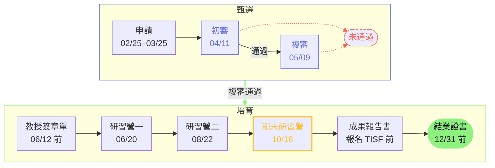

## 簡介

---

高中的我把國際科展玩好玩滿：參加了兩年的[青少年科學人才培育計畫](https://twsf.ntsec.gov.tw/Article.aspx?a=45&lang=1)，也投了兩年的[台灣國際科展](https://twsf.ntsec.gov.tw/tisf/2025/index.html)。

一開始我其實是以小論文為目標在準備，會走到國際科展這個看起來很厲害的舞台，完全是誤打誤撞。也正因為這樣，我覺得自己很有資格代表「從 0 開始」的那群人。

這篇文章會記錄我這兩年的征戰過程，也會分享一些我覺得一般科展學生應該知道的事。

## 青培與國際科展介紹

---

### 青少年科學人才培育計畫

青少年科學人才培育計畫，大家通常直接簡稱「青培」。每年大約三到四月開放報名，送出研究計畫之後，要先後通過初審和複審兩個階段的篩選才能入選。入選之後會有幾次輔導暨報告研習營，每年的場次不太一樣，但不管有幾場都**只能請假一次**，排行程的時候要特別注意。

最後的期末研習營基本上就是一次完整的 TISF 第一階段評審，形式跟正式科展的評審很像，可以把它當成正式上場前的模擬考。

> [!WARNING]
> 青培是**強制綁定國際科展**的：入選就代表當年一定要報名台灣國際科展，而且給的研究經費偏少。如果只是想找經費和資源做研究，我的首選依舊是==中學生獎助計畫==。

以 115 年（2026）為例，日期每年不同，請以[科教館公告](https://twsf.ntsec.gov.tw/Article.aspx?a=440&lang=1)為準。

### 台灣國際科展

台灣國際科展（Taiwan International Science Fair，簡稱 TISF）一樣由科教館主辦，和全國科展並列為高中生最常聽到的兩個大型科展，全國科展勝出的好手們也會來參加 TISF。每年秋天報名，隔年年初在科教館展出和評審。

作品會依照學科分成很多個科別，先經過書面審查，通過的作品才會進到現場的展覽和評審。到了現場，每組都有自己的海報，評審會一個一個攤位來聽你報告、問問題；展場裡也會看到來自其他國家的學生，這大概是「國際」兩個字最有感的地方。獎項分成一到四等獎，另外還有各種特別獎，部分優秀作品還有機會被選為代表隊，出國參加美國的 ISEF 或其他國家的科學展覽。

聽起來很厲害，但它跟一般科展最大的差別，其實就是多了==必須說英文==這個限制。另外，我個人感覺國際科展的作品之間，規模落差比全國科展更大。

詳細的時程和規則每年都會調整，請以[台灣國際科展官網](https://twsf.ntsec.gov.tw/tisf/2025/index.html)的公告為準。

## 關於我的作品

---

我參加的兩年，題目都圍繞在 **Minecraft 伺服器的效能優化**，只是兩年切入的角度不一樣：

| 年份   | 研究方向                 |
| ------ | ------------------------ |
| 第一年 | 減少伺服器本身的效能消耗 |
| 第二年 | 玩家調度與負載平衡       |

> 作品的細節之後會另外寫文章介紹。

## 為什麼要參加青培

---

前面才說中專（中學生獎助計畫）對手搓科展的學生比較友善，那我為什麼還是跑去參加青培？想當然是因為——**我中專沒上**。

不過真正的起點，其實跟大部分高中生一樣：當初只是想豐富學習歷程，去找老師討論要做小論文。後來發現題目的實作比例太高，乾脆把獎助計畫和青培都投投看。那時候的作品跟現在比起來八字都還沒一撇，連實作成品都沒有，抱著賭一把的心態送出去，結果就這樣誤打誤撞進了青培。

### 青培在看什麼

從我的角度來看，青培不一定在意你的研究最後有沒有成果。比起成果，**創新的想法**、**清楚的研究脈絡**、**流暢的口語表達**，還有**能不能和評審老師順暢地討論交流**，才是審核時比較關鍵的地方。

> 以上純屬個人感覺。

### 研習營怎麼用

平心而論，兩年下來大部分的研習營都非常有幫助。不過還是建議挑對自己有用的內容認真參加；真的沒幫助的，不妨直接烙跑，把時間拿去做自己的事。

最後也最重要的，無疑是**期末研習營的模擬科展**。我的建議只有一句：

**不管作品有沒有做完，都把它當成正式的國際科展來準備。**

> ~~另外，把經費花掉也很重要。~~

## 國際科展長怎樣

---

> [!NOTE]
> 我並沒有參加所有活動，這裡只分享我有參加、而且印象深刻的部分。

### 佈展、開幕式、工作坊

除了佈展一定要做以外（我這是在講什麼廢話），其他活動原則上都是自由參與。尤其是開幕式，我會建議不如在家多睡幾個小時，或是多練幾次報告。

工作坊需要自行報名，推薦挑有興趣的參加。主要是可以認識更多選手，甚至是國外的選手，運氣好還能在第一階段評審前偷學一點技巧。

> [!TIP]
> 安全審查基本上不用等到公布結果。海報只要照青培的規格做，一定可以過（不要像我當時傻傻地等 :(）。

### 第一階段評審

接下來就到最重要、也最緊張的時刻。這一天大部分的時間都在緊張地等待中度過，但這也代表你有很多時間可以調適自己的心態。

第一階段評審當時總共 15 分鐘：==10 分鐘報告、5 分鐘提問==。我遇到兩組、共四位評審老師，所以報告要講兩輪（每年的評審人數似乎不太一樣，我也看過只有三位、只需要報告一次的）。當時我是英文海報、中文報告。

提問環節由扮白臉的老師先開始。原則上每位老師的第一題，都是針對他們聽到的重點發問，多半不難回答，我覺得這是讓參賽者放鬆的一題。通常從第二題開始，老師會要求=={blue}用英文回答==，問題也會比較刁鑽，大多是在質疑研究方法，或是問你要如何驗證結果；我也遇過一位老師是用討論的方式進行。

最後借指導老師的一句話，勉勵所有參展的大家：

> **看到那些神級作品不要慌。上台之前要相信自己是最好的，唯有你相信自己的作品，別人才會認可你的作品。**

### 第二階段評審

第二階段評審緊接在隔天，原則上==以英文問答為主==。這個階段有好準備的地方，也有很難準備的地方；而且每位評審、每件作品、每個人的英文程度都不同，所以大家的感受可能差很多。

上一節提到我遇到兩組評審老師，其中一組因為時間不夠，要求我隔天再用英文回答問題。所以這一組有將近一半的提問，是我前一天就能先準備、也比較能主動引導評審方向的。我覺得這是相對簡單、對英文臨場反應也比較友善的部分。

另一組評審的提問就真的比較意想不到了。流程是先請你簡短自我介紹，再從自我介紹裡挑他感興趣的地方發問。以我來說，我從自己開始寫程式的動機講起，之後一路延伸到為什麼會開始挖掘遊戲的底層。

實話實說，這部分我講得不太好。我原本準備的方向都偏技術細節，像是遊戲本身的機制、分析結果等等；比較糟糕的是，我也沒能成功把話題導回我已經準備好的方向。

> [!TIP]
> 建議除了作品本身，也準備一段英文自我介紹，以及「為什麼想做這個題目」的動機，這類問題比技術細節更容易被問到臨場發揮。

### 公開展覽 / 第三階段評審

> [!NOTE]
> 小的不才，無緣進入第三階段評審，所以這裡只分享我對公開展覽的看法。

公開展覽說穿了，就是站在自己的展板前，向每一位停下腳步的民眾或其他參賽者分享你的成果（不過要從早上站到下午，我相信沒幾個選手有這個耐心）。

雖然少了評審的壓力，但我一開始因為知道這次要得獎已經很懸了，其實根本不想去公開展覽（也可以說，我是在其他組別混了很久，才鼓起勇氣回到自己的攤位）。

老實說，因為題目的關係，我的作品無疑是最能讓一般人駐足的那種，而公開展覽也讓我更看見自己作品的價值。這段時間選手也可以去逛其他組別，除了生物、化學這些超出我認知範圍的科別，其他我幾乎都逛過一輪，也和幾位我覺得有趣或很厲害的選手聊了不少。

總結來說，這是一個能和其他選手交流、討論、交朋友的環節，也是整個國際科展期間讓我印象最深刻的環節之一。

## 再戰一年是不服輸還是有熱誠

---

很遺憾，兩個都不是。單純是因為我在 2025 年的科展中，收到了很多可以改進、或者說可以繼續往前走的方向，我也不覺得應該就此止步，所以決定再拚一年。

如大家查得到的，我沒有成功入選 2026 年的複審。但對我個人來說，第二年才算是真正完成了一個研究；技術上，我也因此接觸到了當紅的機器學習。

## 給想參加科展的大家一點建議

---

以下是我想給參加科展（尤其是國際科展）的大家的幾點建議：

1. 雖然不能一稿多投，但還是強烈建議大家==能投就投==，最壞的結果也就是審查沒過而已。
2. 我個人認為，國際科展看重的不是名次，而是作品本身。
3. 可以的話，海報盡量做成英文的，關鍵時刻真的能救命。
4. 有興趣的活動就大膽參加，真的能認識很多不同領域的大佬。
5. 只要沒選上 ISEF 代表，其他名次都不用太在意吧。

## 自言自語

---

就算可能只是運氣好，能在高中參加這麼大的比賽，即使結果不如預期，仍然是我會記一輩子的事；這個作品，也會是我高中最引以為傲的一件作品。

在此特別感謝：

- 爸媽願意讓我做這種不務正業的事
- 王昱珺老師兩年來的指導與陪伴
- 陳瑞宜老師在口頭報告上的指導與幫忙
- 蕭琬莉老師不厭其煩地幫我抓錯字
- 班導的包容
- 那些不知道為什麼覺得我很厲害的朋友和同學
